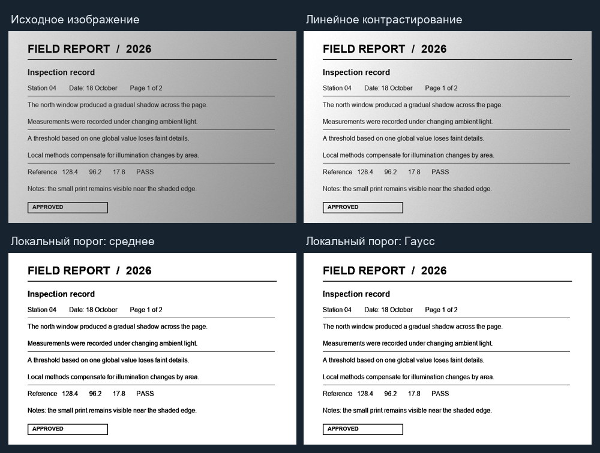
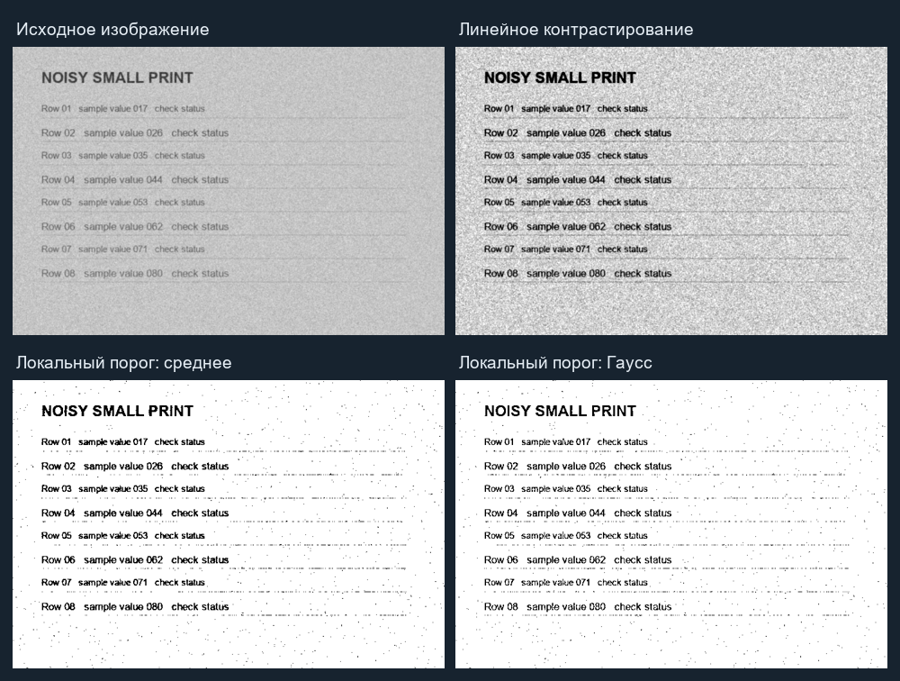

# Лабораторная работа 2

## Основы обработки цифровых изображений

**Вариант:** 11  
**Тема варианта:** локальная пороговая обработка и поэлементные операции с линейным контрастированием.

## 1. Цель работы

Реализовать графическое приложение для обработки изображений, сравнить два метода локальной пороговой обработки и исследовать влияние поэлементных операций и линейного контрастирования. Проверить методы на изображениях с разными дефектами и оценить качество бинаризации на примере с известной эталонной маской.

## 2. Задание варианта

В таблице методички вариант 11 находится на пересечении строки **«Локальная пороговая обработка»** и столбца **«Поэлементные операции + линейное контрастирование»**. Для локальной пороговой обработки методичка требует выбрать и сравнить два метода. В этой работе сравнены порог по локальному среднему и порог по гауссово-взвешенному локальному среднему.

## 3. Программа и запуск

Графическое приложение реализовано на Python с Tkinter, Pillow и NumPy. Оно позволяет:

- открыть собственное изображение или загрузить пример из встроенного набора;
- выполнять поэлементное преобразование яркости и инверсию;
- выполнять процентильное линейное растяжение контраста;
- сравнивать локальное среднее и гауссово среднее с настраиваемыми размером окна, смещением порога и полярностью объектов;
- видеть исходное изображение и результат рядом, сравнивать их гистограммы яркости в отдельных панелях с общей процентной шкалой и метрики;
- сохранять результат в PNG, JPEG или TIFF.

Запуск из каталога `lab2`:

```bash
python -m pip install -r requirements.txt
python main.py
```

Примеры создаются воспроизводимо, с фиксированными начальными значениями генератора случайных чисел:

```bash
python generate_samples.py
```

## 4. Реализованные методы

### 4.1. Подготовка изображения

После открытия файла программа учитывает EXIF-ориентацию и сохраняет полученное изображение как исходное. Каждая команда обработки рассчитывает новый результат именно из исходного изображения, а не из результата предыдущей команды. Поэтому повторное нажатие кнопки с теми же параметрами не приводит к накоплению округления и повторной потере деталей.

Для поэлементных операций и контрастирования изображение приводится к одному из двух представлений:

- `L` — один 8-битный канал яркости для полутоновых изображений;
- `RGB` — три 8-битных цветовых канала для цветных изображений.

Пороговая обработка всегда сначала переводит вход в полутоновое представление `L`. После этого каждый пиксель — целое значение яркости от 0 (чёрный) до 255 (белый). Результат пороговой обработки также является полутоновым бинарным изображением, состоящим только из значений 0 и 255.

### 4.2. Поэлементная операция

Поэлементная операция изменяет каждый пиксель независимо от его соседей. Для каждого положения `(x, y)` и каждого канала вычисляется:

```text
u(x, y) = a · f(x, y) + b
g(x, y) = round(clip(u(x, y), 0, 255))
```

Здесь:

- `f(x, y)` — исходное значение пикселя;
- `a` — коэффициент контраста;
- `b` — сдвиг яркости;
- `clip(u, 0, 255)` ограничивает значение диапазоном допустимых яркостей;
- `round` округляет результат до ближайшего целого перед записью в 8-битное изображение.

В вычислениях используется промежуточный вещественный тип, чтобы дробная часть не отбрасывалась при умножении. Ограничение диапазона производится **до округления**. Это важно для значений за границами: например, отрицательное значение становится 0, а значение выше 255 — 255.

При включённой инверсии после указанного преобразования вычисляется:

```text
g_inv(x, y) = 255 − g(x, y)
```

Порядок операции фиксирован: сначала применяется контраст и сдвиг яркости с ограничением диапазона, затем инверсия. Для RGB преобразование одинаково применяется к R, G и B независимо, а для `L` — к единственному каналу. Поэтому цветовой оттенок RGB может измениться, если каналы изначально имели разные значения.

Допустимы конечные значения `a ≥ 0` и конечное `b`. Значение `a = 1`, `b = 0` оставляет пиксель неизменным (кроме округления, несущественного для целочисленного входа); `a > 1` увеличивает разницу относительно нуля и обычно усиливает контраст; `0 ≤ a < 1` сжимает диапазон; положительное `b` осветляет, отрицательное — затемняет изображение. При больших значениях `a` или `|b|` больше пикселей насыщается в 0 или 255.

### 4.3. Линейное контрастирование

Линейное контрастирование автоматически выбирает нижнюю и верхнюю границы диапазона по распределению значений пикселей. Для полутонового изображения границы вычисляются по всем пикселям; для цветного — отдельно для каждого из каналов RGB. В используемой конфигурации нижняя граница `L` — 1-й процентиль, верхняя граница `H` — 99-й процентиль.

Для каждого пикселя рассчитывается:

```text
g(x, y) = round(clip((f(x, y) − L) · 255 / (H − L), 0, 255))
```

Таким образом:

1. Значения меньше `L` обрезаются до чёрного.
2. Значение `L` отображается примерно в 0.
3. Промежуточные значения линейно распределяются по диапазону яркости.
4. Значение `H` отображается примерно в 255.
5. Значения выше `H` обрезаются до белого.
6. Вещественный результат округляется до целого байта.

Процентили, а не абсолютный минимум и максимум, уменьшают влияние редких выбросов: несколько очень тёмных или светлых шумовых пикселей не задают весь масштаб преобразования. Цена такого подхода — небольшая доля значений вне процентильных границ теряет различия из-за обрезки. Процентили вычисляются средствами NumPy отдельно по каждому каналу цветного изображения; их значения могут быть дробными.

Если `H ≤ L`, преобразование для полутонового изображения не выполняется и исходные пиксели возвращаются без изменения. Для цветного изображения канал с нулевым разбросом оставляется как есть, а остальные каналы контрастируются независимо. Независимое растяжение RGB может изменить соотношение каналов и, следовательно, цветовой оттенок; это осознанная особенность простого поканального метода.

### 4.4. Порог по локальному среднему

Локальная бинаризация принимает решение отдельно для каждого пикселя на основе его окрестности, поэтому порог может меняться по изображению. Для пикселя `(x, y)` рассматривается квадратное окно `N_w(x, y)` нечётного размера `w × w`, центрированное около этого пикселя. Локальная оценка фона — среднее яркостей внутри окна:

```text
μ(x, y) = (1 / w²) · Σ I(i, j),  где (i, j) ∈ N_w(x, y)
T(x, y) = μ(x, y) − C
```

Суммирование и усреднение реализуются фильтром скользящего среднего `BoxBlur` Pillow с радиусом `(w − 1) / 2`, то есть ширина его квадратной окрестности соответствует выбранному размеру окна. Для каждого положения фильтр формирует новое локальное среднее; изображение среднего служит картой локального порога до применения смещения.

Для тёмных объектов (тёмный передний план) правило бинаризации таково:

```text
B(x, y) = 0, если I(x, y) ≤ T(x, y)
B(x, y) = 255, иначе
```

Ноль в выходном изображении обозначает обнаруженный передний план, 255 — фон. Для светлых объектов применяется противоположное сравнение: пиксель считается передним планом, если `I(x, y) ≥ μ(x, y) + C`; найденные светлые объекты также кодируются чёрным, а остальная часть результата — белым. Таким образом, переключатель «тёмные/светлые объекты» меняет критерий обнаружения, но не полярность выходной бинарной маски.

### 4.5. Порог по гауссово-взвешенному среднему

Второй метод строит локальную оценку не равномерным средним, а гауссовым фильтром. В общем виде взвешенное среднее имеет вид:

```text
μ_G(x, y) = Σ(g(i, j) · I(i, j)) / Σ(g(i, j))
```

Здесь `g(i, j)` — вес двумерного гауссова ядра; пиксели около центра окна влияют сильнее, а вклад удалённых пикселей постепенно уменьшается. В реализации используется `GaussianBlur` Pillow, стандартное отклонение задаётся как `σ = (w − 1) / 6`. Это соответствует приблизительной ширине окна около `6σ + 1 = w` пикселей. Полученное изображение размытости трактуется как карта локального среднего, после чего к нему тем же способом добавляется или вычитается смещение `C`.

Для обоих алгоритмов размер окна проверяется до фильтрации: он должен быть целым нечётным числом не меньше 3. Параметр `C` должен быть конечным числом. В интерфейсе размер окна настраивается от 3 до 99 пикселей, а `C` — от −30 до 40.

### 4.6. Влияние размера окна и смещения

Размер окна задаёт пространственный масштаб, по которому оценивается локальный фон:

- небольшое окно лучше следует быстрым изменениям освещения, но сильнее реагирует на шум и толщину штрихов;
- большое окно усредняет более широкую область и обычно лучше подавляет мелкий шум, но может перестать следовать локальным теням и смешать передний план с фоном;
- если размер окна близок к толщине объекта, оценка локального среднего заметно зависит от самого объекта; обычно окно выбирают шире значимых штрихов или деталей.

Смещение `C` отделяет объект от локального фона. Для тёмного переднего плана порог равен `μ − C`: увеличение положительного `C` опускает порог, поэтому меньшему числу пикселей удаётся стать чёрными. Для светлого переднего плана используется `μ + C`: увеличение положительного `C` поднимает порог и также делает условие обнаружения строже. Отрицательное `C`, напротив, облегчает попадание пикселей в передний план и может приводить к выделению большего количества шума.

Оба локальных метода компенсируют плавную неравномерность освещения лучше, чем один глобальный порог, но по-разному определяют фон. Равномерное среднее даёт одинаковый вклад всему окну; гауссово среднее сильнее ориентируется на центральную область. Поэтому выбор метода и параметров зависит от масштаба деталей, характера шума и изменения освещения; универсально лучшего метода для всех изображений нет.

### 4.7. Построение гистограммы яркости

Для сравнительного просмотра цветное изображение переводится в `L`, после чего подсчитывается число пикселей для каждого из 256 уровней яркости. Частота каждого уровня делится на общее число пикселей и умножается на 100:

```text
h(k) = 100 · n(k) / N,  k ∈ {0, 1, ..., 255}
```

`n(k)` — количество пикселей яркости `k`, `N` — число пикселей изображения. Поэтому сумма всех 256 значений гистограммы равна 100 %, в том числе у бинарного результата: его частоты могут быть ненулевыми только для уровней 0 и 255. Если исходник цветной, эта панель показывает распределение его яркости, а не три независимые гистограммы R, G и B.

Исходная гистограмма и гистограмма результата рисуются **в двух отдельных панелях**, чтобы линии не закрывали друг друга. Обе панели используют один вертикальный масштаб: максимум выбирается среди наибольших частот исходника и результата. Каждая гистограмма отображается столбцами; если горизонтальная ширина панели меньше 256 пикселей, соседние исходные бины объединяются суммированием, чтобы сохранить соответствующую долю пикселей. При изменении результата холст очищается и гистограммы строятся заново, поэтому старые значения не остаются на экране.

## 5. Тестовый набор изображений

В комплект включены шесть синтетических примеров размером 720 × 480 пикселей. Они сгенерированы локально скриптом [generate_samples.py](./generate_samples.py), поэтому внешние источники изображений и лицензии не требуются.

| Файл | Дефект / назначение |
|---|---|
| [document_uneven_light.png](./samples/document_uneven_light.png) | Документ с плавным градиентом освещения |
| [receipt_shadow.png](./samples/receipt_shadow.png) | Чек с боковой тенью и мелким текстом |
| [low_contrast_diagram.png](./samples/low_contrast_diagram.png) | Малоконтрастная схема и тонкие линии |
| [text_noise_blur.png](./samples/text_noise_blur.png) | Мелкий текст с шумом и небольшим размытием |
| [textured_illumination.png](./samples/textured_illumination.png) | Текстурированный фон с неоднородной яркостью |
| [spotted_scan.png](./samples/spotted_scan.png) | Скан с пятнистым фоном и неравномерным освещением |

Для зашумлённого текста также сохранена бинарная разметка [ground_truth_text_noise_blur.png](./samples/ground_truth_text_noise_blur.png). Она позволяет вычислять точность и полноту найденного переднего плана.

## 6. Результаты сравнения

### 6.1. Неравномерное освещение и линейное контрастирование

Для документа до обработки разность 95-го и 5-го процентилей яркости составила **102**, стандартное отклонение — **37,0**. После линейного контрастирования эти показатели составили **128** и **46,5** соответственно. Таким образом, растяжение увеличило динамический диапазон документа, не изменив расположение его текстовых элементов.

При окне 31 × 31 и `C = 10` оба локальных метода выделяют текст на изображении с градиентом освещения. Результаты методов отличаются на **0,26 %** пикселей: на этом примере простого градиентного фона методы дают практически одинаковую бинаризацию.



### 6.2. Зашумлённый и размытый мелкий текст

Для сравнения использованы окно 31 × 31 и `C = 20`. Качество рассчитано по эталонной маске: пиксели текста и линий считаются передним планом. Точность показывает долю правильно найденных пикселей среди всех найденных, полнота — долю найденного эталонного переднего плана. Итоговая оценка — F1.

| Метод | Точность (Precision) | Полнота (Recall) | F1 |
|---|---:|---:|---:|
| Локальное среднее | 0,710 | 0,750 | 0,730 |
| Гауссово среднее | **0,814** | 0,755 | **0,783** |

На этом примере гауссово-взвешенное среднее повышает F1 примерно на **0,054**: оно реже относит шумовые точки к переднему плану, сохраняя сопоставимую полноту. Этот вывод относится к данному синтетическому примеру и параметрам; для другого шума и масштаба объектов параметры следует подобрать заново.



## 7. Проверка

Автоматические тесты проверяют:

- формулу поэлементного преобразования, ограничение результата диапазоном 0–255, инверсию и обработку RGB;
- линейное растяжение процентильных границ, постоянные изображения и проверку процентилей;
- бинарный формат результатов, тёмный и светлый передний план;
- оба варианта локального порога, отличие их результатов и отклонение некорректных параметров.

Запуск тестов:

```bash
python -m pytest -q test_processing.py
```

Результат: **18 тестов пройдены**. Также выполнена компиляционная проверка Python-модулей и проверено применение методов ко всем шести тестовым изображениям.

Для повторного создания иллюстраций и измерений из отчёта:

```bash
python compare_methods.py
```

## 8. Вывод

Разработано графическое приложение для обработки растровых изображений по варианту 11. Реализованы поэлементное изменение яркости, инверсия и линейное растяжение контраста, а также два сравниваемых метода локальной пороговой обработки. В приложении доступны тестовые изображения с градиентным и пятнистым освещением, малым контрастом, шумом и размытием. Для зашумлённого изображения проведена воспроизводимая оценка по эталонной маске; на выбранном примере гауссов метод показал более высокую F1-меру.
